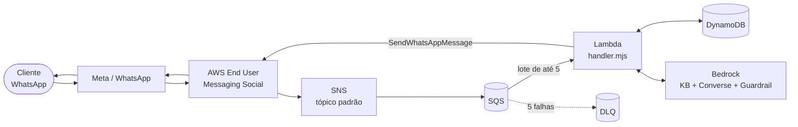
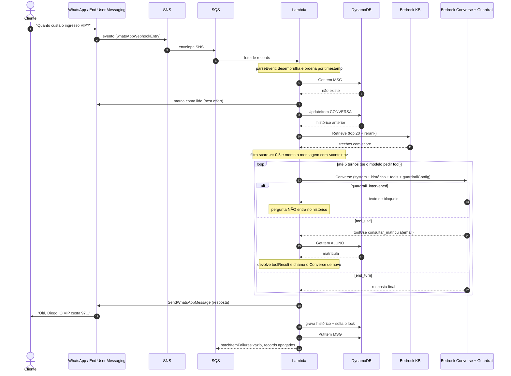
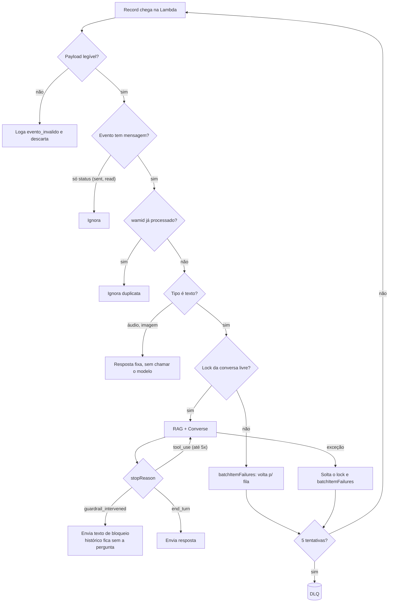

# Fluxo completo: do WhatsApp até a IA e de volta

Exemplo seguido neste documento: o cliente Diego escreve **"Quanto custa o ingresso VIP?"**.

## 1. Visão geral



## 2. Sequência detalhada



## 3. O dado em cada etapa

| # | Onde | Forma do dado |
|---|---|---|
| 1 | Cliente | Texto digitado |
| 2 | End User Messaging → SNS | JSON com cabeçalho AWS e o campo `whatsAppWebhookEntry` como **string JSON** |
| 3 | SNS → SQS | Envelope SNS: o evento acima fica em `Message`, também como string |
| 4 | SQS → Lambda | `event.Records[].body` (string) |
| 5 | `parseEvent.mjs` | Objeto limpo (abaixo) |
| 6 | `rag.mjs` | `[{ fonte, score, texto }]` |
| 7 | `atendente.mjs` → Bedrock | `messages` no formato Converse |
| 8 | Bedrock → Lambda | `output.message`, `stopReason`, `usage`, `trace` |
| 9 | `whatsapp.mjs` | JSON da Cloud API da Meta, em bytes |

Etapa 5, saída do parser:

```json
{
  "sqsMessageId": "sqs-0001",
  "messageId": "wamid.EXEMPLO1",
  "telefone": "14255550150",
  "nome": "Diego",
  "tipo": "text",
  "texto": "Quanto custa o ingresso VIP?",
  "timestamp": 1723506035,
  "phoneNumberId": "phone-number-id-976c72a700aac43eaf573ae050example"
}
```

Etapa 7, o que vai ao modelo. O histórico guarda só a pergunta crua. O contexto do RAG entra apenas na requisição:

```
system:   [ prompt.txt ] [cachePoint 1h] [ "Nome do cliente no WhatsApp: Diego" ]
messages: [ ...histórico anterior...,
            { user: "<contexto>[1] fonte: ... </contexto>
                     Responda ... usando SOMENTE o contexto acima ...
                     Pergunta do cliente: Quanto custa o ingresso VIP?" } ]
toolConfig:      consultar_matricula, gerar_link_pagamento
guardrailConfig: { identifier, version, trace: enabled }
```

Etapa 9, o que volta ao cliente:

```json
{
  "messaging_product": "whatsapp",
  "recipient_type": "individual",
  "to": "14255550150",
  "type": "text",
  "text": { "body": "Olá, Diego! O VIP custa 97 ... Quer o VIP?" }
}
```

## 4. Caminhos alternativos



## 5. Quem faz o quê

| Arquivo | Etapas |
|---|---|
| `src/parseEvent.mjs` | 4 → 5 |
| `src/handler.mjs` | orquestra tudo, decide o que vai para `batchItemFailures` |
| `src/conversa.mjs` | idempotência, lock, histórico (DynamoDB) |
| `src/rag.mjs` | 6 |
| `src/atendente.mjs` | 7 e 8, incluindo o loop de tools |
| `src/tools.mjs` | executa `consultar_matricula` e `gerar_link_pagamento` |
| `src/guardrail.mjs` | `guardrailConfig` e leitura do trace |
| `src/whatsapp.mjs` | 9 |
