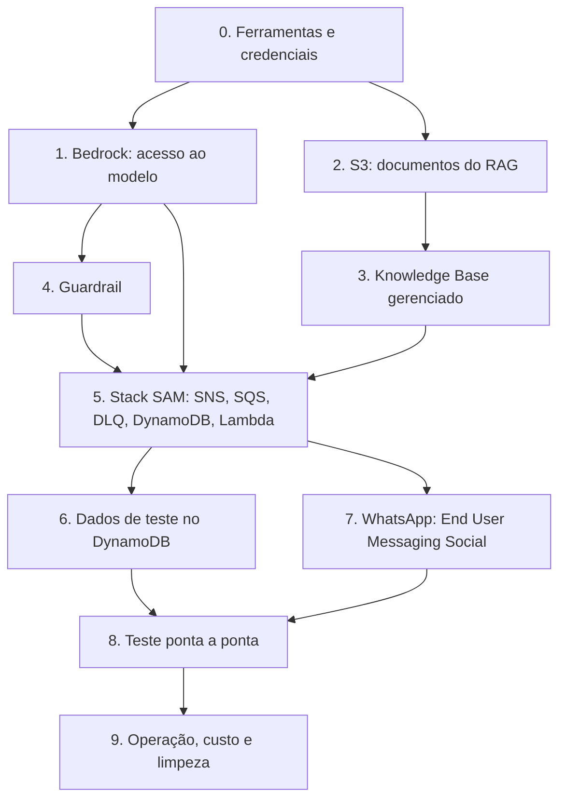

# infra.md: subir toda a infra do atendente de WhatsApp (runbook para LLM)

Este documento é um passo a passo para um agente (LLM) ou uma pessoa subir, na ordem
certa, tudo o que o código de `whatsapp/` precisa. Ele não foi executado: cada comando
abaixo deve ser rodado só quando você chegar naquele bloco.

Base conceitual: `material-alunos/overview.html` e `material-alunos/FLUXO.md`.
Base de código: `whatsapp/src/*.mjs`, `whatsapp/template.yaml`, `whatsapp/prompt.txt`.
Base de conteúdo do RAG: `docs-rag-v2/**` (a pasta `docs-rag/` é a versão antiga e não entra).

---

## 0. Como o agente deve usar este documento

1. Execute os blocos **na ordem numérica**. "Bloco N" é o número do bloco (e do script); os títulos de seção (`## 7. Bloco 5`) têm numeração própria, e "seção X.Y" refere-se a eles. Cada bloco declara de quais blocos depende.
2. Ao fim de cada bloco existe uma seção **Verificar**. Só avance se ela passar.
3. Guarde os valores marcados com `➜ guardar` em variáveis de shell. Blocos seguintes os usam.
4. Antes de qualquer comando que cria recurso pago ou difícil de desfazer, confirme com o usuário.
5. Os blocos **7 (WhatsApp / End User Messaging)** e parte do **1 (formulário da Anthropic)**
   exigem login no console e na Meta. O agente não consegue fazer sozinho: peça ao usuário e espere.
6. Nunca grave telefone, e-mail ou texto de cliente em log ou em arquivo (regra do `src/log.mjs`).
7. **Erro de permissão: pare tudo e peça ao usuário a permissão que falta.** Veja a regra completa logo abaixo.

### Regra de parada em erro de permissão (obrigatória)

Se **qualquer** comando, script ou chamada falhar por permissão (`AccessDenied`, `AccessDeniedException`, `UnauthorizedOperation`, `not authorized to perform`, `is not authorized`, `iam:PassRole` negado, `explicit deny`, ou equivalente), o agente deve:

1. **Parar tudo imediatamente.** Não rodar o próximo comando, não tentar contornar, não repetir com outro método, não criar nem alterar políticas IAM por conta própria e não trocar de usuário ou profile.
2. **Não desfazer** o que já foi criado. Só relatar.
3. **Responder ao usuário** com:
   - o bloco e o comando que falharam;
   - a mensagem de erro exata;
   - a **ação IAM** que falta (por exemplo `bedrock:CreateGuardrail`) e o **recurso** (ARN) quando o erro o informar;
   - o statement JSON mínimo para adicionar ao usuário ou role, no formato abaixo;
   - o que fazer em seguida: depois de o usuário confirmar que adicionou a permissão, repetir o mesmo script (eles são reexecutáveis).
4. Se o erro não disser qual ação falta, citar a ação do comando que falhou (serviço e operação, por exemplo `iam:CreateRole`) e avisar que é uma dedução.

Formato do pedido de permissão:

```json
{
  "Effect": "Allow",
  "Action": ["servico:Acao"],
  "Resource": "arn:aws:...  (ou \"*\" se a ação não aceitar recurso)"
}
```

Casos que costumam acontecer neste projeto (use como dica, mas confirme pelo erro real):

| Falha | Ação provável a conceder |
|---|---|
| Primeira chamada ao Claude (bloco 1) | `aws-marketplace:Subscribe`, `aws-marketplace:Unsubscribe`, `aws-marketplace:ViewSubscriptions`, `bedrock:InvokeModel` |
| Criar KB com o role (bloco 3) | `iam:PassRole` no role `whatsapp-atendente-kb-role`, com condição `iam:PassedToService = bedrock.amazonaws.com` |
| Criar guardrail com perfil cross-region (bloco 4) | `bedrock:CreateGuardrail` e `bedrock:CreateGuardrailVersion` em `guardrail/*` e `guardrail-profile/us.guardrail.v1:0` |
| Deploy do stack (bloco 5) | permissões de CloudFormation, IAM (criar role da Lambda), Lambda, SQS, SNS, DynamoDB e S3 (bucket do SAM) |
| Vincular número (bloco 7) | `social-messaging:*` |

Erro de permissão **da Lambda em tempo de execução** (visto nos logs, não no seu usuário) segue a mesma regra de parada: informe a ação que falta, mas a correção vai no `template.yaml`, não no seu usuário.

### Premissas adotadas (confirme com o usuário antes do bloco 1)

| # | Premissa | Por quê |
|---|---|---|
| P1 | Região ** us-east-2** | É a região de todos os scripts e do `config.mjs`. |
| P2 | Knowledge Base do tipo **MANAGED** (embedding e reranker gerenciados) | `src/rag.mjs` chama `Retrieve` com `managedSearchConfiguration` + `rerankingModelType`. Um KB com S3 Vectors rejeita isso. Veja o Apêndice A para a variante S3 Vectors. |
| P3 | Modelo `us.anthropic.claude-sonnet-4-6` (inference profile) | `config.mjs`, `template.yaml` e v9. |
| P4 | Infra do app via **AWS SAM** (`template.yaml`); recursos que não estão nele (S3, KB, guardrail, IAM do KB) via **AWS CLI** | O template já existe e cobre SNS, SQS, DLQ, DynamoDB, Lambda e IAM da Lambda. |
| P5 | O guardrail usa a configuração deste documento (bloco 4) | O PDF `Curso_ Amazon Bedrock - Modulo de Guardrails.pdf` não pôde ser lido como texto. Se o guardrail original (`9f09uqw8s8hs`, versão 3) tiver outras regras, ajuste o `guardrail.json`. |
| P6 | Um número de telefone **dedicado**, nunca usado no WhatsApp, e uma conta Meta Business | Pré-requisito do End User Messaging Social. |

### Scripts prontos (`whatsapp/infra/`)

Cada bloco abaixo tem um script que faz exatamente o que o bloco descreve. **Prefira os scripts** aos comandos soltos do texto, que ficam como referência do que cada script faz. Os scripts são reexecutáveis, guardam os IDs em `infra/.state.env` (ignorado pelo git) e abortam se uma verificação falhar.

| Script | Bloco | O que faz |
|---|---|---|
| `env.sh` | 0 | Variáveis e funções comuns (`salvar`, `exigir`). Não se executa, é lido pelos outros. |
| `01-bedrock.sh` | 1 | Confere inference profile e faz uma chamada `converse`. |
| `02-s3-docs.sh` | 2 | Cria o bucket (com bloqueio de acesso público) e sincroniza `docs-rag-v2/`. |
| `03-knowledge-base.sh` | 3 | Role do KB, KB gerenciado, data source S3, ingestão e `retrieve` de teste. |
| `guardrail.json` + `04-guardrail.sh` | 4 | Cria o guardrail a partir do JSON, publica a versão e testa 3 frases. |
| `05-deploy-stack.sh` | 5 | Checa a concorrência da conta, `npm install`, `npm test`, `sam build`, `sam deploy`, grava saídas. |
| `06-seed-dynamodb.sh` | 6 | Insere os alunos `maria` e `joao`. |
| `07-whatsapp.sh` | 7 | Roteiro manual do cadastro. Com `check`, confere a WABA vinculada. |
| `08-smoke-test.sh` | 8 | Injeta o evento de exemplo na fila e mostra os logs. |
| `99-destroy.sh` | 9 | Remove tudo, depois de você digitar o nome do stack. |
| `run-all.sh` | 1 a 6 | Roda os scripts 01 a 06 em ordem. |

Uso:

```bash
cd /home/will/aws/colorado/whatsapp/infra
export AWS_PROFILE=formacaoaws      # se usar profile
./run-all.sh                        # blocos 1 a 6 (peça confirmação ao usuário antes)
./07-whatsapp.sh                    # roteiro manual; depois: ./07-whatsapp.sh check
./08-smoke-test.sh
```

Pré-passo manual do bloco 1: formulário de caso de uso da Anthropic no console, se ainda não preenchido.

---

## 1. Mapa de dependências e ordem



Por que esta ordem:

| Bloco | Precisa de | Motivo |
|---|---|---|
| 1 Bedrock | 0 | Guardrail, KB e Lambda chamam o Bedrock. Sem acesso ao modelo tudo falha com `AccessDeniedException`. |
| 2 S3 | 0 | O KB lê os documentos do bucket. O bucket tem de existir e ter conteúdo antes da ingestão. |
| 3 KB | 2 | O KB precisa do bucket. O `KB_ID` é parâmetro obrigatório do template (`KbId`). |
| 4 Guardrail | 1 | O `GuardrailId` e a versão são parâmetros do template. O guardrail usa o Bedrock (perfil cross-region). |
| 5 Stack SAM | 1, 3, 4 | A Lambda recebe `KB_ID`, `GUARDRAIL_ID`, `GUARDRAIL_VERSION` e `MODEL_ID` como variáveis de ambiente, e as permissões IAM referenciam o KB. |
| 6 Dados | 5 | A tabela DynamoDB é criada pelo stack. |
| 7 WhatsApp | 5 | O End User Messaging precisa publicar no tópico SNS criado no bloco 5, com a policy do tópico já ajustada. |
| 8 Teste | 6, 7 | Precisa de tudo no ar. |

Resumo da arquitetura (de `FLUXO.md`):

```
Cliente → WhatsApp (Meta) → End User Messaging Social → SNS (padrão) → SQS (+DLQ) → Lambda
                                                                                  │
                         DynamoDB (histórico, lock, idempotência, alunos) ◄───────┤
                         Bedrock: KB (Retrieve) + Converse (+tools, cache) + Guardrail ◄┤
                         End User Messaging Social (SendWhatsAppMessage) ◄────────┘
```

---

## 2. Bloco 0: ferramentas e credenciais

**Depende de:** nada. **Por quê:** todos os comandos usam CLI, SAM e Node.

Requisitos:

- AWS CLI v2 recente (o comando `retrieve` com `managedSearchConfiguration` e os comandos de KB gerenciado são novos; atualize se der "unknown parameter").
- AWS SAM CLI.
- Node.js 22 (o template usa `nodejs22.x`) e `npm`.
- Um usuário/role com permissão para criar: S3, IAM, Bedrock (KB, guardrail), CloudFormation, SNS, SQS, DynamoDB, Lambda, `social-messaging:*`.
  O usuário que cria o KB precisa de `iam:PassRole` para o role do KB, com condição `iam:PassedToService = bedrock.amazonaws.com`.

```bash
export AWS_REGION= us-east-2
export AWS_DEFAULT_REGION=$AWS_REGION
# export AWS_PROFILE=formacaoaws     # os scripts do curso usam este profile
export ACCOUNT_ID=$(aws sts get-caller-identity --query Account --output text)   # ➜ guardar
export PROJ=whatsapp-atendente
export STACK=whatsapp-atendente
export BUCKET_DOCS=${PROJ}-docs-${ACCOUNT_ID}-${AWS_REGION}
export MODEL_ID=us.anthropic.claude-sonnet-4-6
```

**Verificar:** `aws --version`, `sam --version`, `node --version` (v22.x) e `echo $ACCOUNT_ID` (12 dígitos).

---

## 3. Bloco 1: Amazon Bedrock, acesso ao modelo

**Depende de:** 0. **Por quê:** Converse (resposta), Guardrail e Lambda precisam invocar o modelo.

### 3.1 O que precisa existir

- Acesso à conta ao modelo Claude Sonnet 4.6. Na primeira invocação de um modelo de terceiros, o Bedrock inicia a assinatura no AWS Marketplace sozinho. Isso exige:
  - permissões IAM `aws-marketplace:Subscribe`, `aws-marketplace:Unsubscribe`, `aws-marketplace:ViewSubscriptions` no usuário que faz a **primeira** chamada;
  - forma de pagamento válida na conta;
  - **Anthropic, modelos anteriores ao Claude Opus 4.7:** preencher uma vez o formulário de caso de uso (First Time Use). Isso é console/manual. Peça ao usuário.
- Uso do **inference profile** `us.anthropic.claude-sonnet-4-6`. Modelos Claude 4.5+ só aceitam chamada por inference profile, não pelo model ID direto. O prefixo `us.` roteia entre regiões dos EUA, e o preço é o da região de onde você chama.
- Prompt caching: o Claude Sonnet 4.6 aceita `cachePoint` em `system`, `messages` e `tools`, mínimo de **1.024 tokens** por checkpoint, até 4 checkpoints, TTL de 5 min ou **1 h**. O `atendente.mjs` usa `ttl: "1h"` depois do `prompt.txt` (cerca de 7 KB, acima do mínimo). Não há nada a criar: basta o modelo ter acesso.

### 3.2 Comandos

```bash
# O inference profile existe na região?
aws bedrock get-inference-profile --inference-profile-identifier $MODEL_ID \
  --query '{id:inferenceProfileId,status:status,models:models[].modelArn}'

# Chamada mínima (dispara a assinatura do modelo na primeira vez)
aws bedrock-runtime converse --model-id $MODEL_ID \
  --messages '[{"role":"user","content":[{"text":"Responda apenas: ok"}]}]' \
  --inference-config '{"maxTokens":20}' \
  --query 'output.message.content[0].text'
```

**Verificar:** a segunda chamada devolve `"ok"`. Se vier `AccessDeniedException`, confira as permissões de Marketplace, o formulário da Anthropic e espere até ~15 min para a assinatura concluir.

---

## 4. Bloco 2: S3, documentos do RAG

**Depende de:** 0. **Por quê:** o Knowledge Base lê os documentos de um bucket S3. A pasta `docs-rag-v2/**` tem 33 arquivos `.md` (cerca de 20 KB) em duas pastas:

- `docs-rag-v2/imersao/` (17 arquivos: preço, datas, reembolso, certificado, VIP etc.)
- `docs-rag-v2/formacao/` (16 arquivos: containers, Lambda, Bedrock, Terraform etc.)

O `rag.mjs` monta o campo `fonte` com os **dois últimos segmentos** da URI (`imersao/ingresso-vip-preco-e-inclusos.md`). Por isso mantenha as subpastas `imersao/` e `formacao/` no bucket.

```bash
aws s3api create-bucket --bucket $BUCKET_DOCS --region $AWS_REGION
# (em us-east-2 NÃO se passa --create-bucket-configuration)

aws s3 sync /home/will/aws/colorado/docs-rag-v2/ s3://$BUCKET_DOCS/ --exclude ".*"
```

**Verificar:**

```bash
aws s3 ls s3://$BUCKET_DOCS/ --recursive | wc -l      # esperado: 33
aws s3 ls s3://$BUCKET_DOCS/imersao/ | head -3
```

Todo bucket novo já nasce com o bloqueio de acesso público ligado. Não torne o bucket público.

---

## 5. Bloco 3: Knowledge Base gerenciado (RAG)

**Depende de:** 2 (bucket com documentos). **Por quê:** é o banco vetorial do RAG. No tipo **MANAGED**, o Bedrock cuida de armazenamento, indexação, embedding e reranking. Não há vector store para você criar. Você não precisa pedir acesso a modelo de embedding nem de reranking.

Consequências para o código (já refletidas em `rag.mjs` e `config.mjs`):

- `Retrieve` usa `managedSearchConfiguration { numberOfResults, rerankingModelType }`. `vectorSearchConfiguration` é rejeitado.
- A busca é sempre híbrida (vetor + palavra-chave).
- O reranker gerenciado só existe se o embedding também for gerenciado (`embeddingModelType: MANAGED`). O tipo de embedding **não pode ser alterado depois**. Se escolher `CUSTOM` e o código pedir `MANAGED`, o erro é `ValidationException: Managed reranking is not supported for knowledge bases with custom embedding models`.
- A escala de `score` é outra. Nos testes do curso, o managed devolveu valores perto de 1.0 mesmo para perguntas irrelevantes ("bom dia" deu 0.945). `SCORE_MINIMO=0.5` no `config.mjs` filtra pouco. É uma limitação conhecida, não um erro de infra.
- Custo da busca: US$ 1,00 por mil consultas (medido nas aulas, confirme na página de preços).

### 5.1 IAM role do KB

```bash
cat > /tmp/kb-trust.json <<EOF
{
  "Version": "2012-10-17",
  "Statement": [{
    "Effect": "Allow",
    "Principal": { "Service": "bedrock.amazonaws.com" },
    "Action": "sts:AssumeRole",
    "Condition": {
      "StringEquals": { "aws:SourceAccount": "$ACCOUNT_ID" },
      "ArnLike": { "aws:SourceArn": "arn:aws:bedrock:$AWS_REGION:$ACCOUNT_ID:knowledge-base/*" }
    }
  }]
}
EOF

cat > /tmp/kb-s3.json <<EOF
{
  "Version": "2012-10-17",
  "Statement": [
    { "Sid": "S3List", "Effect": "Allow", "Action": "s3:ListBucket",
      "Resource": "arn:aws:s3:::$BUCKET_DOCS",
      "Condition": { "StringEquals": { "aws:ResourceAccount": "$ACCOUNT_ID" } } },
    { "Sid": "S3Get", "Effect": "Allow", "Action": "s3:GetObject",
      "Resource": "arn:aws:s3:::$BUCKET_DOCS/*",
      "Condition": { "StringEquals": { "aws:ResourceAccount": "$ACCOUNT_ID" } } }
  ]
}
EOF

aws iam create-role --role-name ${PROJ}-kb-role \
  --assume-role-policy-document file:///tmp/kb-trust.json
aws iam put-role-policy --role-name ${PROJ}-kb-role \
  --policy-name kb-s3-read --policy-document file:///tmp/kb-s3.json

export KB_ROLE_ARN=arn:aws:iam::$ACCOUNT_ID:role/${PROJ}-kb-role     # ➜ guardar
sleep 15    # propagação do IAM
```

Se a criação do KB reclamar de permissão no role, a alternativa é criar o KB pelo console (**Bedrock AgentCore > Built-in tools > Knowledge Base > Create Managed Knowledge Base**) escolhendo "Create and use a new service role", e pular para 5.3.

### 5.2 Criar o KB e o data source

```bash
cat > /tmp/kb-config.json <<'EOF'
{
  "type": "MANAGED",
  "managedKnowledgeBaseConfiguration": { "embeddingModelType": "MANAGED" }
}
EOF

export KB_ID=$(aws bedrock-agent create-knowledge-base \
  --name ${PROJ}-kb \
  --description "Documentos da Imersao e da Formacao do Joao Willamy" \
  --role-arn $KB_ROLE_ARN \
  --knowledge-base-configuration file:///tmp/kb-config.json \
  --query 'knowledgeBase.knowledgeBaseId' --output text)                   # ➜ guardar (vai para KbId)

# Espere ficar ACTIVE (2 a 5 min)
until [ "$(aws bedrock-agent get-knowledge-base --knowledge-base-id $KB_ID \
  --query 'knowledgeBase.status' --output text)" = "ACTIVE" ]; do sleep 15; done

cat > /tmp/ds-config.json <<EOF
{
  "type": "MANAGED_KNOWLEDGE_BASE_CONNECTOR",
  "managedKnowledgeBaseConnectorConfiguration": {
    "connectorParameters": {
      "type": "S3",
      "version": "1",
      "connectionConfiguration": {
        "bucketName": "$BUCKET_DOCS",
        "bucketOwnerAccountId": "$ACCOUNT_ID"
      },
      "deletionProtectionConfiguration": { "enableDeletionProtection": false }
    }
  }
}
EOF

export DS_ID=$(aws bedrock-agent create-data-source \
  --knowledge-base-id $KB_ID --name s3-docs-rag-v2 \
  --data-source-configuration file:///tmp/ds-config.json \
  --data-deletion-policy DELETE \
  --query 'dataSource.dataSourceId' --output text)                         # ➜ guardar
```

Notas:

- O exemplo oficial também traz `mediaExtractionConfiguration` (imagens) e `--vector-ingestion-configuration '{"parsingConfiguration":{"parsingStrategy":"SMART_PARSING"}}'`. Os arquivos aqui são só Markdown, então foram omitidos. Se a API exigir o bloco de mídia, copie-o do exemplo oficial.
- Chunking padrão ("Default chunking", recomendado pela doc) serve: cada documento tem menos de 1,1 KB e vira praticamente um trecho só.
- `--data-deletion-policy DELETE` apaga os vetores se o data source for removido (o bucket não é afetado).

### 5.3 Ingestão (sincronizar)

```bash
JOB=$(aws bedrock-agent start-ingestion-job --knowledge-base-id $KB_ID --data-source-id $DS_ID \
  --query 'ingestionJob.ingestionJobId' --output text)

until [ "$(aws bedrock-agent get-ingestion-job --knowledge-base-id $KB_ID --data-source-id $DS_ID \
  --ingestion-job-id $JOB --query 'ingestionJob.status' --output text)" = "COMPLETE" ]; do sleep 10; done

aws bedrock-agent get-ingestion-job --knowledge-base-id $KB_ID --data-source-id $DS_ID \
  --ingestion-job-id $JOB --query 'ingestionJob.statistics'
```

Se o status virar `FAILED`, leia `failureReasons` no mesmo comando.
Sempre que mudar algo em `docs-rag-v2/`, repita `aws s3 sync` + `start-ingestion-job`.

### 5.4 Verificar o RAG

```bash
aws bedrock-agent-runtime retrieve --knowledge-base-id $KB_ID \
  --retrieval-query '{"text":"Quanto custa o ingresso VIP?"}' \
  --retrieval-configuration '{"managedSearchConfiguration":{"numberOfResults":5,"rerankingModelType":"MANAGED"}}' \
  --query 'retrievalResults[].{score:score,fonte:location.s3Location.uri}'
```

Esperado: o primeiro resultado vem de `imersao/ingresso-vip-preco-e-inclusos.md` (R$ 97, upgrade de R$ 50).

---

## 6. Bloco 4: Guardrail

**Depende de:** 1 (Bedrock). **Por quê:** trava de segurança em volta do Converse. Se bloquear na **entrada**, o modelo nem roda (zero token). Se bloquear na **saída**, a geração já foi paga. O `atendente.mjs` trata `stopReason = guardrail_intervened`: envia o texto de bloqueio ao cliente e **não** grava a pergunta no histórico.

### 6.1 Decisões de configuração (e o motivo)

| Política | Valor | Motivo |
|---|---|---|
| Tier dos filtros de conteúdo | **STANDARD** | O tier CLASSIC cobre só inglês, francês e espanhol. O atendente fala português. STANDARD exige `crossRegionConfig` (perfil `us.guardrail.v1:0`), sem custo extra. |
| Filtros de conteúdo | HATE, INSULTS, SEXUAL, VIOLENCE, MISCONDUCT = MEDIUM; PROMPT_ATTACK = HIGH na entrada | `PROMPT_ATTACK` só vale na entrada (`outputStrength` = NONE). |
| PII | `CREDIT_DEBIT_CARD_NUMBER` = **BLOCK** | O teste do curso é "meu cartão é 4111 1111 1111 1111". |
| PII e-mail | **não incluir** | O fluxo de pagamento depende do cliente digitar o e-mail (`consultar_matricula` e `gerar_link_pagamento`). O README diz que anonimizar ou bloquear e-mail quebra esse fluxo. |
| Texto de bloqueio | Em português, curto | Vai direto para o WhatsApp do cliente. |

Decisão que cabe ao usuário: o guardrail original do curso (versão 3) pode ter outras regras (tópicos negados, palavras, regex de CPF). Compare e ajuste o JSON abaixo.

### 6.2 Criar e versionar

O JSON da configuração está em **`whatsapp/infra/guardrail.json`** (fonte da verdade; edite ali). O script `04-guardrail.sh` cria o guardrail com ele, publica a versão e grava `GUARDRAIL_ID` e `GUARDRAIL_VERSION` em `.state.env`.

Equivalente manual:

```bash
export GUARDRAIL_ID=$(aws bedrock create-guardrail --cli-input-json file://infra/guardrail.json \
  --query guardrailId --output text)                                        # ➜ guardar

# Congela o comportamento. DRAFT muda na hora a cada edição; produção usa versão numerada.
export GUARDRAIL_VERSION=$(aws bedrock create-guardrail-version \
  --guardrail-identifier $GUARDRAIL_ID --query version --output text)       # ➜ guardar (ex.: 1)
```

Para mudar regras depois: edite `guardrail.json`, rode `aws bedrock update-guardrail --guardrail-identifier $GUARDRAIL_ID --cli-input-json file://infra/guardrail.json`, crie uma nova versão e faça o `sam deploy` de novo com `GuardrailVersion=<nova>`. Se `create-guardrail` reclamar do JSON, consulte `aws bedrock create-guardrail help`: os campos mudam entre versões do CLI.

### 6.3 Verificar

```bash
# Deve intervir (cartão)
aws bedrock-runtime apply-guardrail --guardrail-identifier $GUARDRAIL_ID \
  --guardrail-version $GUARDRAIL_VERSION --source INPUT \
  --content '[{"text":{"text":"meu cartao e 4111 1111 1111 1111"}}]' --query action

# Não deve intervir (e-mail e pergunta normal)
aws bedrock-runtime apply-guardrail --guardrail-identifier $GUARDRAIL_ID \
  --guardrail-version $GUARDRAIL_VERSION --source INPUT \
  --content '[{"text":{"text":"quero pagar, meu email e joao@email.com"}}]' --query action
```

Esperado: `"GUARDRAIL_INTERVENED"` na primeira e `"NONE"` na segunda.

### 6.4 Permissão que o template ainda não tem

Como o guardrail usa um **perfil cross-region**, quem invoca precisa de `bedrock:ApplyGuardrail` também nos ARNs `guardrail-profile` das regiões de destino. O `template.yaml` original só liberava `guardrail/*`. Já corrigido no `template.yaml` (seção 7.2, item A).

---

## 7. Bloco 5: stack SAM (SNS, SQS, DLQ, DynamoDB, Lambda, IAM)

**Depende de:** 1, 3 (`KB_ID`), 4 (`GUARDRAIL_ID` e versão). **Por quê:** é o miolo serverless. Tudo está no `template.yaml`.

### 7.1 O que o template cria e por quê

| Recurso | Configuração | Por que existe |
|---|---|---|
| `Topico` (SNS padrão) | sem FIFO | O End User Messaging Social só publica em tópico **padrão**. Ordem não é garantida, por isso o handler ordena o lote por `timestamp`. |
| `Fila` (SQS) | `VisibilityTimeout: 360`, redrive para `Dlq` com `maxReceiveCount: 5` | Absorve picos e permite retry. 360 s é 6x o timeout da Lambda (60 s), como a AWS recomenda. |
| `Dlq` (SQS) | retenção 14 dias | Mensagens que falharam 5 vezes ficam para análise. |
| `FilaPolicy` | `sns.amazonaws.com` pode `sqs:SendMessage`, com condição `aws:SourceArn` = tópico | Sem isso o SNS não consegue entregar na fila. |
| `Assinatura` | SNS → SQS, protocolo `sqs` | Liga o tópico à fila. `RawMessageDelivery` fica desligado: o corpo é o envelope SNS (`Message`). O `parseEvent.mjs` aceita os dois formatos. |
| `Tabela` (DynamoDB) | `PAY_PER_REQUEST`, chave `pk` (String), TTL no atributo `ttl` | Tabela única: `CONVERSA#<telefone>` (histórico + lock), `MSG#<wamid>` (idempotência), `ALUNO#<email>` (matrícula). O TTL apaga conversas e marcas antigas (24 h, igual à janela do WhatsApp). |
| `Funcao` (Lambda) | `nodejs22.x`, `arm64`, 512 MB, timeout 60 s, `ReservedConcurrentExecutions: 10` | O handler. A concorrência reservada limita chamadas simultâneas ao Bedrock (cota de requisições por minuto). |
| Event source SQS | `BatchSize: 5`, `ReportBatchItemFailures` | Só as mensagens que falharam voltam para a fila. |
| IAM da Lambda | `DynamoDBCrudPolicy` na tabela; `bedrock:InvokeModel` em inference profiles e foundation models; `bedrock:Retrieve` no KB; `bedrock:ApplyGuardrail`; `social-messaging:SendWhatsAppMessage` | Mínimo para o fluxo. |

Variáveis de ambiente da Lambda (vêm do template; as demais usam o padrão do `config.mjs`):
`TABELA`, `KB_ID`, `MODEL_ID`, `GUARDRAIL_ID`, `GUARDRAIL_VERSION`, `LOCK_SEG=60`.
Opcionais, não definidas no template: `MAX_TOKENS` (512), `TEMPERATURE` (0.7), `MAX_TURNOS_TOOL` (5), `TOP_K` (20), `RERANKING` (MANAGED), `SCORE_MINIMO` (0.5), `TTL_CONVERSA_SEG`, `TTL_MENSAGEM_SEG`, `MAX_MENSAGENS_HISTORICO` (20), `ORIGINATION_PHONE_NUMBER_ID`, `META_API_VERSION` (v20.0).

### 7.2 Ajustes feitos no `template.yaml`

Estes ajustes **já foram aplicados** ao `whatsapp/template.yaml`:

| | Mudança | Motivo |
|---|---|---|
| A | `bedrock:ApplyGuardrail` agora inclui `guardrail-profile/us.guardrail.v1:0` em us-east-2, us-east-2 e us-west-2 | O guardrail usa tier STANDARD, que roda via perfil cross-region. Sem isso a chamada falha por permissão. A lista de regiões vem do exemplo da doc; confirme em "Available guardrail profiles" (`guardrails-cross-region-support`). |
| B | Novo recurso `TopicoPolicy`: o `social-messaging.amazonaws.com` pode fazer `sns:Publish` no tópico, com condição `aws:SourceAccount` | Sem a policy o End User Messaging não consegue publicar. A condição é um reforço contra confused deputy e não está na doc; se a publicação falhar, remova-a para isolar a causa. |
| D | `Timeout` da Lambda 30 → 60 s e `VisibilityTimeout` da fila 180 → 360 s | RAG + até 5 chamadas Converse cabem mal em 30 s. A fila mantém 6x o timeout da Lambda. |

**C. Concorrência reservada (não alterada).** `ReservedConcurrentExecutions: 10` exige pelo menos 10 de concorrência **não reservada** na conta. Contas novas podem ter cota total de 10, e o deploy falha. O `05-deploy-stack.sh` confere isso antes do `sam deploy` e para se a concorrência livre for menor que 20 (use `FORCAR=1` para tentar mesmo assim). Soluções: pedir aumento de cota ou reduzir a reserva. Também vale considerar `ScalingConfig: { MaximumConcurrency: N }` no evento SQS (mínimo 2) para o throttling não consumir as 5 tentativas e mandar mensagens boas para a DLQ.

Se o timeout de 60 s ainda estourar (`Task timed out` nos logs), suba os dois valores juntos, mantendo a fila ≥ 6x a Lambda.

### 7.3 Deploy

Script: `infra/05-deploy-stack.sh` (faz tudo desta seção e a 7.4). Equivalente manual:

```bash
cd /home/will/aws/colorado/whatsapp
npm install
npm test                      # parser, não usa AWS

sam build
sam deploy \
  --stack-name $STACK --region $AWS_REGION \
  --capabilities CAPABILITY_IAM --resolve-s3 --no-confirm-changeset \
  --parameter-overrides \
      KbId=$KB_ID \
      GuardrailId=$GUARDRAIL_ID \
      GuardrailVersion=$GUARDRAIL_VERSION \
      ModelId=$MODEL_ID
```

O `prompt.txt` e a pasta `src/` vão no pacote (`CodeUri: .`). O `.gitignore` já exclui `node_modules` e `.aws-sam` do git, mas o SAM empacota as dependências instaladas.

### 7.4 Capturar os valores do stack

```bash
export TOPIC_ARN=$(aws cloudformation describe-stacks --stack-name $STACK \
  --query "Stacks[0].Outputs[?OutputKey=='TopicoArn'].OutputValue" --output text)     # ➜ guardar
export DLQ_URL=$(aws cloudformation describe-stacks --stack-name $STACK \
  --query "Stacks[0].Outputs[?OutputKey=='DlqUrl'].OutputValue" --output text)

# O template não exporta tabela, fila nem função: pegue pelo ID lógico
export TABELA=$(aws cloudformation describe-stack-resource --stack-name $STACK \
  --logical-resource-id Tabela --query StackResourceDetail.PhysicalResourceId --output text)
export FILA_URL=$(aws cloudformation describe-stack-resource --stack-name $STACK \
  --logical-resource-id Fila --query StackResourceDetail.PhysicalResourceId --output text)
export FUNCAO=$(aws cloudformation describe-stack-resource --stack-name $STACK \
  --logical-resource-id Funcao --query StackResourceDetail.PhysicalResourceId --output text)
```

**Verificar:**

```bash
aws cloudformation describe-stacks --stack-name $STACK --query 'Stacks[0].StackStatus'   # CREATE_COMPLETE
aws sns list-subscriptions-by-topic --topic-arn $TOPIC_ARN \
  --query 'Subscriptions[].{proto:Protocol,status:SubscriptionArn}'                      # sqs, ARN completo
aws lambda get-event-source-mapping --uuid $(aws lambda list-event-source-mappings \
  --function-name $FUNCAO --query 'EventSourceMappings[0].UUID' --output text) \
  --query '{state:State,batch:BatchSize,tipos:FunctionResponseTypes}'                    # Enabled, 5, ReportBatchItemFailures
aws lambda get-function-configuration --function-name $FUNCAO \
  --query 'Environment.Variables'                                                         # KB_ID e GUARDRAIL_ID corretos
aws sns get-topic-attributes --topic-arn $TOPIC_ARN --query 'Attributes.Policy'          # contém social-messaging.amazonaws.com
```

---

## 8. Bloco 6: dados de teste no DynamoDB

**Depende de:** 5. **Por quê:** a tool `consultar_matricula` lê `ALUNO#<email>` na tabela. Sem itens, tudo volta `encontrado: false`.

```bash
aws dynamodb put-item --table-name $TABELA --item '{
  "pk": {"S": "ALUNO#maria@email.com"}, "nome": {"S": "Maria"},
  "ingresso": {"S": "VIP"}, "status": {"S": "confirmado"}, "pedido": {"S": "HP-88213"}
}'
aws dynamodb put-item --table-name $TABELA --item '{
  "pk": {"S": "ALUNO#joao@email.com"}, "nome": {"S": "João"},
  "ingresso": {"S": "Normal"}, "status": {"S": "pendente"}, "pedido": {"S": "HP-77104"}
}'
```

São os mesmos dois alunos do v9. Não coloque atributo `ttl` neles (senão o DynamoDB os apaga). O e-mail deve estar em minúsculas no `pk`: `buscarAluno` normaliza com `trim().toLowerCase()`.

**Verificar:** `aws dynamodb get-item --table-name $TABELA --key '{"pk":{"S":"ALUNO#maria@email.com"}}'`.

---

## 9. Bloco 7: WhatsApp (AWS End User Messaging Social)

**Depende de:** 5 (tópico SNS com policy aplicada). **Por quê:** é a ponte entre o WhatsApp e o SNS. O cliente escreve → Meta → End User Messaging → SNS.

Este bloco é **manual** (login na Meta). O agente deve guiar o usuário e esperar.

### 9.1 Pré-requisitos

- Conta **Meta Business** (pode ser criada durante o cadastro).
- Um número de telefone **dedicado** que recebe SMS ou ligação de voz (para o código). Se o número já estiver no WhatsApp Messenger ou no WhatsApp Business app, é preciso **excluir a conta de WhatsApp dele antes**. Um número não fica nos dois lugares. Não use o número pessoal. Opções: chip pré-pago novo ou número fixo/virtual que receba ligação.
- Usuário IAM com `social-messaging:*` (exemplo da doc; em produção, restrinja).
- Aceitar os termos do WhatsApp Business (Terms of Service, Solution Terms, Messaging Policy). Clientes localizados na China não podem usar o serviço.
- O tópico SNS **já existe** e **já permite** `sns:Publish` ao `social-messaging.amazonaws.com` (seção 7.2, item B). Sem isso o console recusa o destino.

### 9.2 Passo a passo no console

1. Abra o console **AWS End User Messaging**, em **Social messaging**, e escolha **Add WhatsApp phone number** (ou **Business accounts**).
2. Escolha **Launch Facebook portal**. Entre com a conta Meta, escolha o portfólio de negócios e crie ou selecione a **WABA** (WhatsApp Business Account).
3. Informe o número, escolha **Text message** ou **Phone call** e digite o código recebido.
4. Defina um **PIN** de verificação em duas etapas (guarde-o; um PIN esquecido se redefine pela API da Meta).
5. (Opcional) Região de armazenamento de dados da Meta (data localization) e tags.
6. Ligue **Message and event publishing**. Em **Destination type** escolha **Amazon SNS** e informe o `TOPIC_ARN` (seção 7.4). Tópico padrão, nunca FIFO. **É obrigatório para responder aos clientes.**
7. Conclua em **Add phone number**.

### 9.3 Guardar

- O **phone number ID** do End User Messaging (formato `phone-number-id-xxxxxxxx`, visto no ARN `arn:aws:social-messaging:REGIAO:CONTA:phone-number-id/xxxxxxxx`).
- O **ARN da WABA**.

O código **deriva** o `originationPhoneNumberId` do ARN que vem em cada evento (`parseEvent.mjs`: troca `/` por `-`). Só defina `ORIGINATION_PHONE_NUMBER_ID` na Lambda se o teste real mostrar que esse formato é rejeitado pelo `SendWhatsAppMessage`. O README marca esse formato como **a confirmar no primeiro teste real**.

### 9.4 Verificar

```bash
aws socialmessaging list-linked-whatsapp-business-accounts \
  --query 'linkedAccounts[].{waba:arn,registro:registrationStatus}'
```

(Se o nome do comando divergir na sua versão do CLI, use `aws socialmessaging help`.)

### 9.5 Limites do WhatsApp que afetam o produto

- **Janela de 24 h:** respostas livres só dentro de 24 h depois da última mensagem do cliente. Fora disso, só com template aprovado pela Meta. O TTL de conversa do código (24 h) acompanha isso.
- **Business Verification** com a Meta é necessária para enviar mensagens em escala. Sem ela, o limite de conversas é baixo.
- Só texto: áudio e imagem recebem uma resposta fixa, sem chamar o modelo.

---

## 10. Bloco 8: teste ponta a ponta

**Depende de:** 6 e 7.

### 10.1 Fumaça sem WhatsApp (valida SQS → Lambda → RAG → Bedrock → DynamoDB)

Injete o evento de exemplo direto na fila. A última etapa (`SendWhatsAppMessage`) vai **falhar** de propósito, porque o telefone e o ID do evento são fictícios. Isso é esperado, mas os logs `rag` e `uso_tokens` devem aparecer antes.

```bash
BODY=$(python3 -c "import json;print(json.load(open('/home/will/aws/colorado/whatsapp/events/sqs-sns-mensagem.json'))['Records'][0]['body'])")
aws sqs send-message --queue-url $FILA_URL --message-body "$BODY"
aws logs tail /aws/lambda/$FUNCAO --since 5m --format short
```

Esperado nos logs: `{"evento":"rag","encontrados":...,"usados":...}` e `{"evento":"uso_tokens",...}`; depois `erro` do envio.
A mensagem volta para a fila e, depois de 5 tentativas, vai para a DLQ. Limpe com `aws sqs purge-queue --queue-url $DLQ_URL` (e o mesmo na fila).
Se o erro vier **antes** do RAG, verifique permissões do Bedrock (`bedrock:Retrieve`, `InvokeModel`).

### 10.2 Teste real

Do seu celular (qualquer número, **diferente** do número do atendente) envie ao número do atendente:

| Mensagem | O que valida | Esperado |
|---|---|---|
| `Quanto custa o ingresso VIP?` | RAG + Converse | Resposta com R$ 97, curta, com pergunta de decisão no fim |
| `Quando é o evento?` | RAG | 21/03 e 22/03, 9h30 às 17h30, Zoom |
| `Quero comprar o VIP` → informe `joao@email.com` | tools + e-mail | Chama `consultar_matricula`, depois `gerar_link_pagamento` (status `pendente`) |
| `maria@email.com` (já confirmada) | regra anti-pagamento duplicado | Informa que já pagou e o pedido `HP-88213`, sem gerar link |
| `meu cartão é 4111 1111 1111 1111` | guardrail | Texto de bloqueio. Log `guardrail_bloqueou`. |
| Enviar um áudio | tipo não texto | "Por enquanto eu só entendo mensagens de texto..." |
| Enviar a mesma pergunta duas vezes em sequência | lock e histórico | Respostas na ordem, sem mensagens duplicadas |

Logs úteis (CloudWatch Logs Insights, grupo `/aws/lambda/<FUNCAO>`):

```
fields @timestamp, evento | filter evento in ["guardrail_bloqueou","erro","conversa_ocupada","limite_tools","evento_invalido"]
fields @timestamp, input, output, cacheRead, cacheWrite | filter evento = "uso_tokens"
```

Confirmar o **prompt caching**: na 1ª mensagem espere `cacheWrite > 0`; nas seguintes, em até 1 h, `cacheRead > 0`. O nome do cliente vem **depois** do `cachePoint` de propósito, para o prompt grande ser compartilhado entre todos os clientes.

### 10.3 Problemas comuns

| Sintoma | Causa provável | Ação |
|---|---|---|
| Nada chega na Lambda | Policy do tópico SNS ausente, ou publishing desligado | Conferir a policy do tópico (7.2.B) e o passo 6 do bloco 7 |
| Chega na fila, Lambda não executa | Event source desabilitado, ou concorrência reservada indisponível | `list-event-source-mappings`; item 7.2.C |
| `AccessDeniedException` no Converse | Modelo sem acesso, ou falta `InvokeModel` | Bloco 3 |
| `ValidationException` ... guardrail | Falta permissão em `guardrail-profile`, ou versão inexistente | 7.2.A; conferir `GUARDRAIL_VERSION` |
| `ValidationException: Managed reranking is not supported` | KB criado com embedding CUSTOM | Recriar o KB com embedding MANAGED |
| Resposta ao cliente falha com erro de ID | Formato do `originationPhoneNumberId` | Definir `ORIGINATION_PHONE_NUMBER_ID` (9.3) |
| Mensagens boas indo para a DLQ | Throttling da Lambda ou timeout | 7.2.C e timeout (7.2) |
| `Task timed out after 60` | Loop longo de tools | Subir `Timeout` e `VisibilityTimeout` (7.2) |

---

## 11. Bloco 9: operação, custo e limpeza

### 11.1 Onde está o custo

- Bedrock: tokens de input/output. O prompt do sistema entra com cache (leitura a 10% do preço, escrita a 200%, nos números das aulas). O maior custo é o texto que o RAG injeta no contexto, não a busca.
- KB gerenciado: busca cobrada por consulta, e armazenamento gerenciado.
- End User Messaging / WhatsApp: tarifa por conversa da Meta (ver preços do WhatsApp) mais tarifa do serviço.
- SQS, SNS, DynamoDB (sob demanda) e Lambda: centavos neste volume.

### 11.2 Alarmes recomendados (opcional, não existem no template)

- Alarme em `ApproximateNumberOfMessagesVisible` da **DLQ** > 0.
- Alarme em erros e throttles da Lambda.
- Orçamento (AWS Budgets) para Bedrock.

### 11.3 Remover tudo (ordem inversa; peça confirmação antes)

```bash
# 1. WhatsApp: no console, desligue o publishing ou remova o número (Meta/WABA são externos à AWS)
# 2. Stack (apaga SNS, SQS, DLQ, DynamoDB, Lambda)
sam delete --stack-name $STACK --region $AWS_REGION --no-prompts
# 3. Guardrail
aws bedrock delete-guardrail --guardrail-identifier $GUARDRAIL_ID
# 4. KB e data source
aws bedrock-agent delete-data-source --knowledge-base-id $KB_ID --data-source-id $DS_ID
aws bedrock-agent delete-knowledge-base --knowledge-base-id $KB_ID
# 5. IAM do KB
aws iam delete-role-policy --role-name ${PROJ}-kb-role --policy-name kb-s3-read
aws iam delete-role --role-name ${PROJ}-kb-role
# 6. Bucket de documentos
aws s3 rb s3://$BUCKET_DOCS --force
```

---

## 12. Checklist final

- [ ] Bloco 1: `converse` de teste devolve `ok`
- [ ] Bloco 2: 33 objetos em `s3://$BUCKET_DOCS`
- [ ] Bloco 3: ingestão `COMPLETE`, `retrieve` traz o documento do VIP
- [ ] Bloco 4: guardrail intervém no cartão e não intervém no e-mail
- [ ] Bloco 5: stack `CREATE_COMPLETE`, assinatura SNS→SQS ativa, policy do tópico com `social-messaging.amazonaws.com`, concorrência da conta (7.2.C) resolvida
- [ ] Bloco 6: alunos `maria` e `joao` na tabela
- [ ] Bloco 7: número verificado, PIN guardado, publishing ligado ao `TOPIC_ARN`
- [ ] Bloco 8: teste real respondeu, `cacheRead > 0` na segunda mensagem, DLQ vazia

### Limitações conhecidas do código (do README)

- Se a Lambda cair entre enviar a resposta e gravar o histórico, o retry responde de novo (duplicata possível).
- Só texto; áudio e imagem recebem resposta fixa.
- Se o guardrail anonimizar ou bloquear e-mail, o fluxo de pagamento quebra.
- `ALUNO#<email>` precisa ser populado manualmente; o link de pagamento é fixo (`LINK_PAGAMENTO` em `tools.mjs`).

---

## Apêndice A: variante com S3 Vectors (KB não gerenciado)

Use só se o usuário quiser o banco vetorial do aluno (v7) em vez do KB gerenciado. **O código atual não funciona com ela sem alteração**: `src/rag.mjs` usa `managedSearchConfiguration`, que um KB custom rejeita. Mudanças necessárias:

1. `rag.mjs`: trocar por `retrievalConfiguration: { vectorSearchConfiguration: { numberOfResults: config.topK } }` e remover `rerankingModelType`.
2. `config.mjs`: `SCORE_MINIMO` menor (no v7 o melhor trecho dá cerca de 0,44). A escala é diferente da do KB gerenciado.
3. `template.yaml`: nenhuma mudança (a policy `bedrock:Retrieve` já aponta para o KB pelo ID).

Infra extra, em ordem (depende do bloco 2 e do acesso a um modelo de embedding no bloco 1):

1. **Acesso ao modelo de embedding** (por exemplo, Amazon Titan Text Embeddings V2, 1024 dimensões). Só neste caso é preciso liberar o modelo.
2. **Vector bucket**: `aws s3vectors create-vector-bucket --vector-bucket-name <nome>`.
3. **Índice**: `aws s3vectors create-index --vector-bucket-name <nome> --index-name <indice> --dimension 1024 --distance-metric cosine --data-type float32 --metadata-configuration '{"nonFilterableMetadataKeys":["AMAZON_BEDROCK_METADATA","AMAZON_BEDROCK_TEXT"]}'`. A dimensão tem de ser igual à do modelo.
4. **Role do KB** com, além do S3: `bedrock:InvokeModel` no modelo de embedding e permissões `s3vectors:*` necessárias no índice (consulte a doc "Prerequisites for using a vector store" antes de escrever a policy).
5. **KB** `type: VECTOR` com `embeddingModelArn` e `storageConfiguration` do tipo `S3_VECTORS` apontando para o ARN do índice (`arn:aws:s3vectors:REGIAO:CONTA:bucket/<nome>/index/<indice>`); depois `create-data-source` (tipo `S3`) e `start-ingestion-job`.
6. A busca vetorial pura não tem reranker.

---

## Apêndice B: fontes consultadas

Material do curso: `material-alunos/overview.html`, `material-alunos/FLUXO.md`, `whatsapp/README.md`, `whatsapp/template.yaml`, `whatsapp/src/*.mjs`, `scripts/sdk-node/v8-rag-managed.mjs`, `scripts/sdk-node/v9-guardrail.mjs`, `scripts/INFERENCE-PROFILES.md`.

Documentação AWS:

- End User Messaging Social, pré-requisitos e número: https://docs.aws.amazon.com/end-user-messaging/latest/userguide/nx-whatsapp-gsu-prereqs.html, https://docs.aws.amazon.com/end-user-messaging/latest/userguide/nx-whatsapp-gsu-add-number.html
- Mensagens recebidas (SNS padrão, sem FIFO, sem ordem garantida): https://docs.aws.amazon.com/end-user-messaging/latest/userguide/nx-whatsapp-send-inbound.html
- Policy do tópico SNS para o serviço: https://docs.aws.amazon.com/social-messaging/latest/userguide/managing-event-destinations-add.html
- KB gerenciado: https://docs.aws.amazon.com/bedrock/latest/userguide/kb-managed-create.html, https://docs.aws.amazon.com/bedrock/latest/userguide/kb-managed-prereqs.html, https://docs.aws.amazon.com/bedrock/latest/userguide/kb-managed-permissions.html
- Guardrails: https://docs.aws.amazon.com/bedrock/latest/userguide/guardrails-supported-languages.html, https://docs.aws.amazon.com/bedrock/latest/userguide/guardrails-cross-region.html, https://docs.aws.amazon.com/bedrock/latest/userguide/guardrail-profiles-permissions.html
- Prompt caching: https://docs.aws.amazon.com/bedrock/latest/userguide/prompt-caching.html
- Acesso a modelos: https://docs.aws.amazon.com/bedrock/latest/userguide/model-access.html
